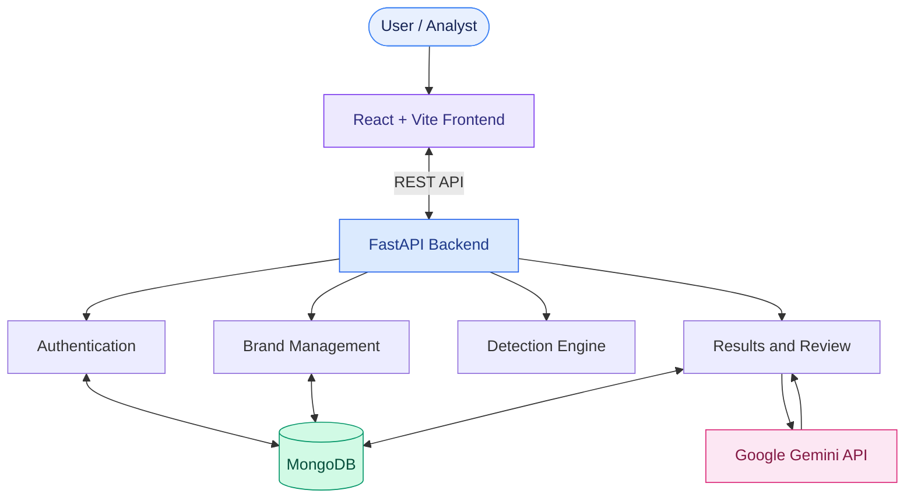

# 🛡️ DigiShield — Digital Risk Protection Platform

**AI-Powered Brand Protection | Social Profile Detection | Application Impersonation Analysis**

DigiShield is an AI-assisted platform designed to identify potential brand impersonation, analyze suspicious social profiles, compare logos, and support threat investigation through Generative AI.

## 🎯 Key Features

- **User Authentication:** Registration and login through FastAPI.
- **Brand Management:** Maintain official brand and identity information.
- **Social Profile Detection:** Identify suspicious profile names using RapidFuzz similarity matching.
- **Logo Comparison:** Compare candidate logos against official brand assets.
- **AI-Powered Analysis:** Use Google Gemini to generate insights from stored findings.
- **Results & Review:** Centralize findings for investigation and review.
- **Modular Architecture:** Separate frontend, backend, database, and detection logic.

## 🧰 Technology Stack

- **Frontend:** React, Vite, JavaScript, CSS
- **Backend:** Python, FastAPI
- **Database:** MongoDB, PyMongo
- **AI Integration:** Google Gemini API
- **Text Similarity:** RapidFuzz
- **Visual Analysis:** Python-based logo comparison modules
- **API Documentation:** OpenAPI / Swagger UI
- **Version Control:** Git and GitHub

## 🏗️ System Architecture



### Architecture Overview

1. **Presentation Layer:** React dashboard for brand management and threat review.
2. **API Layer:** FastAPI handles requests, authentication, and application workflows.
3. **Detection Layer:** Python modules perform profile-name similarity and logo comparison.
4. **Data Layer:** MongoDB stores application data and findings.
5. **AI Layer:** Gemini generates contextual analysis for supported findings.

## 🔍 Detection Workflow

1. Maintain official brand information.
2. Evaluate available candidate profiles and logo assets.
3. Identify potential similarities using detection modules.
4. Present findings for review.
5. Request AI-assisted analysis when needed.
6. Review evidence and decide on appropriate action.

## 🔄 Development Phases

- **Phase 1 — Foundation:** React frontend, FastAPI backend, authentication, and MongoDB integration.
- **Phase 2 — Detection:** Brand management, fuzzy profile matching, and logo comparison.
- **Phase 3 — AI Integration:** Gemini-powered analysis and Results & Review workflow.
- **Phase 4 — Live Monitoring (Planned):** Integration with authorized social-platform and application data sources.
- **Phase 5 — Advanced AI (Planned):** Transformer embeddings, neural-network-based risk classification, and CNN-based visual similarity detection.

## 📁 Project Structure

```text
ByteNexus/
├── main.py
├── auth.py
├── database.py
├── demo_scanners.py
├── test_gemini.py
├── detection.py
├── logo_detection.py
├── social_detection_practice.py
├── create_demo_logos.py
├── social_profiles.json
├── sample_logos/
├── src/
│   ├── App.jsx
│   ├── App.css
│   ├── api.js
│   ├── index.css
│   └── components/
├── public/
├── package.json
├── vite.config.js
├── index.html
└── README.md
```

## ⚙️ Getting Started

### Prerequisites

- Python
- Node.js and npm
- MongoDB or MongoDB Atlas
- Google Gemini API key for AI analysis

### Backend Setup

```bash
python -m venv .venv
```

Activate the virtual environment, then install the backend dependencies required by the project.

```bash
uvicorn main:app --reload
```

API documentation: `http://127.0.0.1:8000/docs`

### Frontend Setup

```bash
npm install
npm run dev
```

Open the local URL displayed by Vite.

## 🔐 Environment Configuration

Configure required credentials in a local `.env` file using the variable names expected by the backend.

```dotenv
MONGODB_URI=your_mongodb_connection_string
GEMINI_API_KEY=your_gemini_api_key
```

Never commit API keys, database credentials, or other secrets to GitHub.

## 🚀 Future Enhancements

- **Live Threat Monitoring:** Authorized external API integrations and scheduled scans.
- **Transformers:** Semantic matching of profile descriptions and brand-related content.
- **Neural Networks:** Risk classification using multiple threat signals.
- **CNNs:** Visual feature extraction for logo and application-icon comparison.
- **Multimodal Detection:** Combine text, image, and metadata signals.
- **Production Readiness:** Audit logs, role-based access, automated testing, and deployment.

## 👥 Project Information

- **Project:** DigiShield — Digital Risk Protection Platform
- **Repository:** [ByteNexus on GitHub](https://github.com/jhansivemuluri/ByteNexus)
- **Focus:** AI-assisted brand protection and digital identity risk analysis

---

*Detect potential risks. Investigate with context. Protect digital identity with intelligence.*
